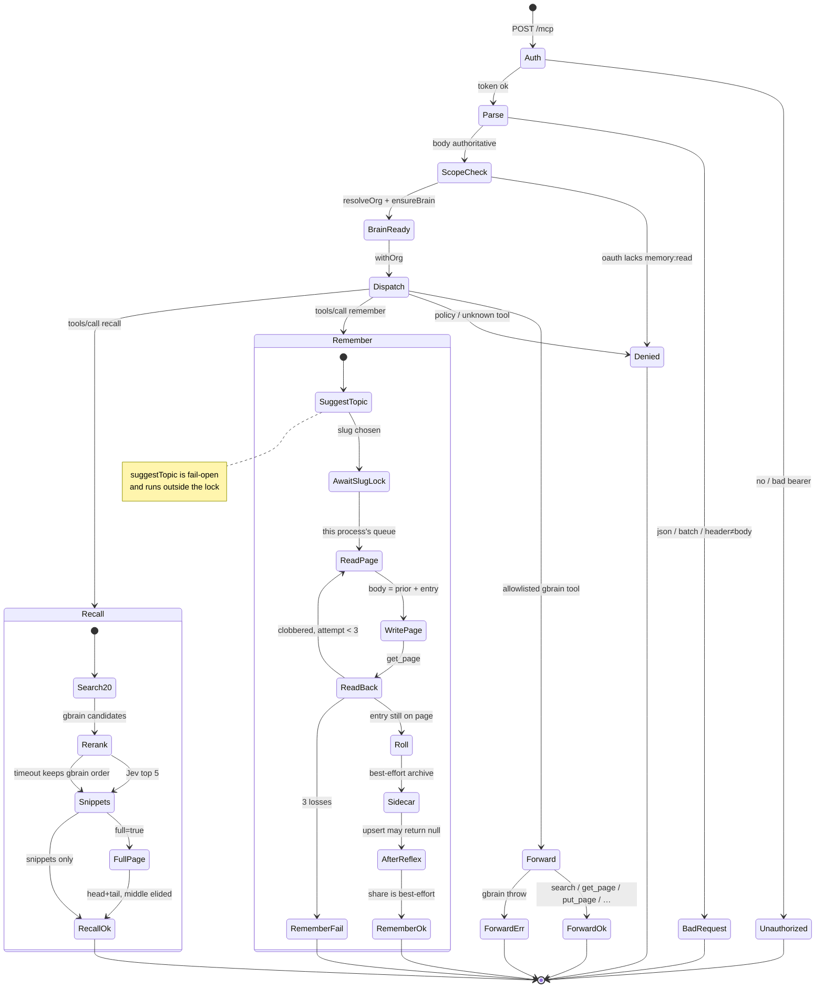
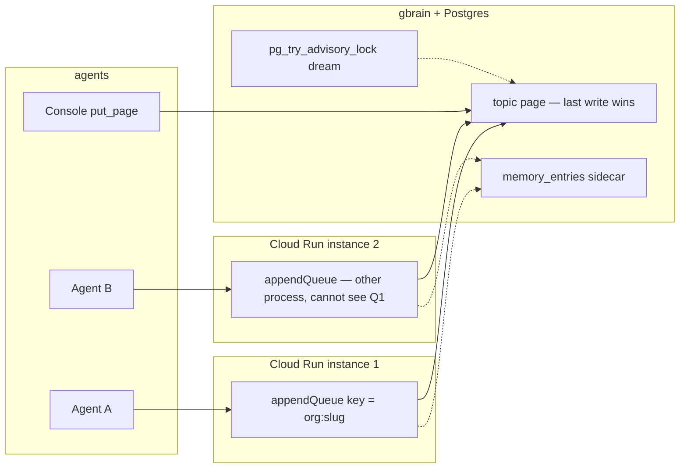

# Engram memory and routing statechart

Build-in-public snapshot of how a request and a memory move through the
gateway. This is a reading of the code at the commit this document shipped
with, not a proposal to change it.

Tweet-sized render: [statechart.png](statechart.png) (1600×900, from
`render_statechart.py`). TLC findings: [findings.md](findings.md).

Source of the states:

| Path | Role |
| --- | --- |
| `gateway/src/index.ts` `handleMcp` | Auth, parse, header/body routing, org, brain |
| `gateway/src/proxy.ts` `resolveMcpRouting` / `remember` / `recall` / `callTool` | Dispatch, append lock, read-modify-write, search |
| `gateway/src/reflex/write.ts` `suggestTopic` | Topic route, fail-open, **outside** the slug lock |
| `gateway/src/reflex/client.ts` | Jev retries, circuit breaker, fail-open |
| `gateway/src/brain.ts` | Per-org gbrain child, start coalesce, idle evict, crash respawn |
| `gateway/src/memory-entries.ts` | Sidecar upsert after the page write is confirmed |
| `gateway/src/dream/lock.ts` | Nightly advisory lock (separate from the live path) |

gbrain `put_page` is last-write-wins. There is no compare-and-swap.

## One picture



## Concurrency points



What the in-process queue covers, and what it does not:

- **Same replica, same slug.** `serializeBySlug` in `proxy.ts` chains promises.
  A thrown append does not poison the next one (`prior.catch(() => {})`).
- **Same replica, different slugs.** Concurrent. Fine.
- **Two replicas, or remember vs `put_page`.** No shared lock. The write is
  `put_page` of a whole body. The loser of last-write-wins is supposed to
  notice on read-back and retry, up to `MAX_APPEND_ATTEMPTS = 3`.
- **Read-back only looks before ack.** After `savedBody.includes(entry)`,
  `rollTopicPage` rewrites live from that snapshot, then the handler returns
  `ok`. Another replica can still overwrite the page after that check.
- **Dream lock.** Session-level `pg_try_advisory_lock` on a pooled
  `dataSql()` connection. Unlock is a second query and may hit another
  connection.

## Remember — states a write moves through

1. **Route.** `handleMcp` authenticates, rejects batching, treats MCP headers
   as assertions against the body (`resolveMcpRouting`). Org + `ensureBrain`.
2. **Suggest topic.** No explicit topic → `search` + Jev `routeTopic`. Below
   confidence, or Jev down → dated `notes/…` slug. This is **not** under the
   slug lock.
3. **Lock.** `serializeBySlug(orgId:slug)` — this process only.
4. **Stamp.** ISO timestamp is taken once, so a retry re-files the same bullet.
5. **Read → write → read-back** (max 3). `get_page` / `put_page` / `get_page`.
   Success is “the exact bullet is still on the page,” not “the write call
   returned.”
6. **Roll.** If the live page is over `TOPIC_ROLL_AT`, oldest entries go to
   `*-archive`, then live is rewritten from the **confirmed snapshot**. A throw
   here is swallowed: the entry is already considered saved.
7. **Sidecar.** `upsertMemoryEntry` on fingerprint. Failure is logged and
   becomes `entry_id` omitted; the MCP result is still `ok`.
8. **After.** `afterRemember` (classify / pairwise / review) and
   `shareAfterWrite` (personal → team). Both `.catch(() => {})`.

Failure paths that do **not** retry the page write: auth, parse, header
conflict, policy deny, empty text, gbrain throw (bubbles as `-32603`),
sidecar / reflex / share errors after confirm.

## Recall — states a read moves through

1. Same MCP front door as remember (auth, route, brain).
2. `search` with `limit: 20` (engram’s cap, not the caller’s).
3. Jev rerank to 5. Timeout or empty answers → original gbrain order, sliced
   to 5.
4. Optional `get_page` of the highest-score hit, then `truncateEnds`.
5. Attribution from trails is decoration and may fail open.

A recall can race a remember: candidates are a search snapshot; `full` is a
later `get_page`. Those two reads are not one snapshot.

## Routed request — failure and retry

```
                     ┌─ 401 JWT / missing token ────────── Unauthorized
POST /mcp ─ Auth ────┤
                     └─ ok ─ Parse ─┬─ bad json / batch / header conflict ─ 400
                                    └─ scope / org / brain ─ tools/call
                                              │
                    remember page loop ◄──────┤ 3× only when read-back misses
                    Jev evaluate 3× 429/529 ──┤ then fail-open (no page retry)
                    Jev circuit 5 fails / 10m ┤ fail-open
                    gbrain crash ── respawn ──┘ exponential, per org
```

There is no request-level retry on the gateway. The shim retries only
idempotent calls and selected frontend statuses (`test/shim.test.ts`).

## What this picture is for

The companion TLA+ model in `docs/architecture/formal/` treats each box above
as a step other agents can interleave with. TLC’s findings are in
[findings.md](findings.md).
